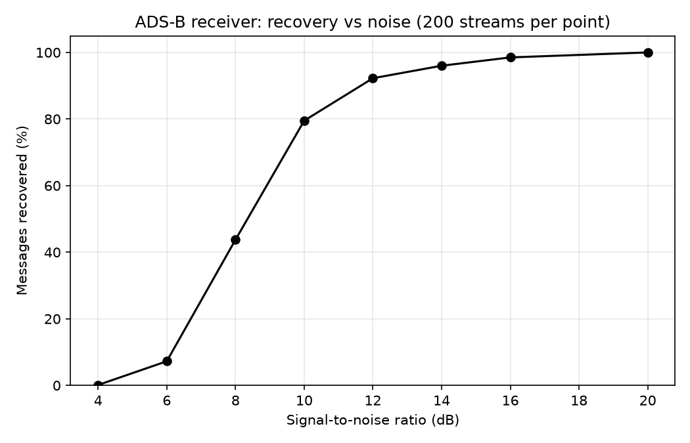

# adsb-decoder
ADS-B (Mode S) receiver in Python: decodes aircraft messages from noisy simulated radio samples

# ADS-B Decoder

A receiver for ADS-B (Mode S, 1090 MHz) aircraft messages, written in Python with NumPy.
It finds messages inside a noisy stream of radio samples and decodes callsign and altitude.

**Note:** the radio signal is simulated, not recorded from a real antenna. The 4 test messages are real, published ADS-B messages. Built step by step with AI guidance; I wrote and ran the code.

## Pipeline
1. Generate samples (`frame_gen.py`): 8 µs preamble + 112 bits, pulse-position modulation, 2 samples per µs
2. Add Gaussian noise at a chosen SNR
3. Find the preamble by correlation with a template (`receiver.py`)
4. Read the 112 bits by comparing the first and second half of each bit
5. Check the CRC-24 (`crc.py`); discard the frame if it fails
6. Decode fields (`fields.py`): ICAO address, callsign, altitude

## Results

200 noisy streams per SNR level, 4 messages each:
| SNR | Recovered |
|---|---|
| 20 dB | ~100% |
| 14 dB | ~96% |
| 10 dB | ~80% |
| 8 dB | ~44% |

Across all runs, **0 wrong messages were accepted** because the CRC rejects damaged frames.

## What I learned
- The CRC gives zero wrong messages because each message carries 24 check bits calculated from the rest of it. If noise flips even one bit, the check fails and the receiver throws the frame away instead of decoding wrong data.
- Messages are lost at low SNR because noise flips bits (or hides the preamble), and a single flipped bit is enough to fail the CRC, so the whole message is dropped. The receiver would rather lose a message than report a wrong altitude.

## Limitations
- Simulated signal only; real recordings would add timing drift and interference.
- Velocity messages are detected but not decoded.
- Position (latitude/longitude) decoding is not implemented.

## Run it
    pip install numpy matplotlib
    python3 receiver.py
